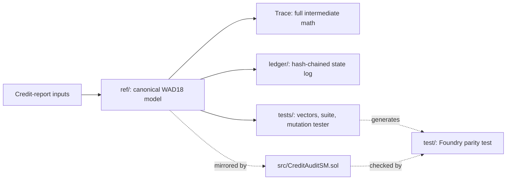

<div align="center">

# RUAX- CAI Credit Audit State Machine

### Reproducibility Capsule · v0.1.0

Deterministic, integer-only (10¹⁸ fixed-point) credit-report audit logic with a full printed trace.


-informational)


**Michael Aaron Russell** · [ORCID 0009-0001-3360-6709](https://orcid.org/0009-0001-3360-6709)

</div>

---

> **Scope notice.** This is **not** the FICO or VantageScore algorithm. Those are proprietary and unpublished. This capsule implements only the publicly documented factor weights (35 / 30 / 15 / 10 / 10) and the standard utilization ratio. See [`paper/WHITEPAPER.md`](paper/WHITEPAPER.md), section 2.

## Contents

1. [Overview](#overview)
2. [Quick start](#quick-start)
3. [Architecture](#architecture)
4. [Repository layout](#repository-layout)
5. [Verification](#verification)
6. [Solidity parity](#solidity-parity)
7. [Reproducibility scope](#reproducibility-scope)
8. [Limitations](#limitations)
9. [Citation](#citation)
10. [License](#license)

## Overview

This capsule is a credit-report audit state machine built entirely on integer arithmetic scaled by 10¹⁸ (WAD18). Identical inputs produce identical outputs, with no floating-point behavior involved.

- **Canonical reference:** Python (`ref/`).
- **Mirror implementation:** Solidity (`src/CreditAuditSM.sol`), which follows the Python model.
- **Transparency:** every run prints its full intermediate math (the *Trace*).
- **Audit trail:** state transitions are recorded in a hash-chained Cognitive State Ledger (`ledger/`).

## Quick start

**Requirements:** Python 3.10 or later. No third-party packages, no network access.

```sh
sh run.sh
```

### Expected output

```text
<paste the final lines of a clean run, including the top-level hash>
```

## Architecture



## Repository layout

| Path | Contents |
|---|---|
| `ref/` | Canonical Python model |
| `ledger/` | Hash-chained Cognitive State Ledger |
| `src/` | Solidity mirror (`CreditAuditSM.sol`) |
| `tests/` | Test vectors, test suite, mutation tester, Foundry test generator |
| `test/` | Generated Foundry parity test |
| `paper/` | White paper (`WHITEPAPER.md`) |
| `run.sh` | Single-command entry point |
| `MANIFEST.sha256` | SHA-256 hashes of all capsule files |

## Verification

**1. File integrity**

```sh
sha256sum -c MANIFEST.sha256
```

**2. Deterministic re-run.** Run `sh run.sh` twice, or on a second machine, and compare the printed top-level hash.

**3. Mutation testing**

| Item | Value |
|---|---|
| Operator set | `<list>` |
| Mutants generated | `<n>` |
| Killed | `<n>` |
| Survivors | `<n>` |
| Equivalent (excluded, with justification) | `<n>` |

## Solidity parity

> **Status: not verified.** The Solidity mirror was *not executed* when this capsule was built.

To check parity yourself, install [Foundry](https://book.getfoundry.sh/) and `forge-std`, then run:

```sh
forge test -vv
```

## Reproducibility scope

| Claim | Basis |
|---|---|
| No floating-point drift | Integer-only arithmetic (WAD18) |
| Bit-exact output | Verified on `<Python version · OS · architecture>`. Other platforms are unconfirmed until tested. |
| Zero dependencies | Python standard library only |

## Limitations

- Research artifact. It is not a consumer credit score.
- Not for lending, underwriting, or adverse-action decisions.
- Does not reproduce any bureau or vendor scoring model.
- Solidity parity is unverified until the Foundry tests are run.

## Citation

```bibtex
@software{russell_wad18_credit_audit_2026,
  author  = {Russell, Michael Aaron},
  title   = {WAD18 Credit Audit State Machine: Reproducibility Capsule},
  version = {0.1.0},
  year    = {2026},
  orcid   = {0009-0001-3360-6709}
}
```

## License

`<SPDX identifier, e.g. MIT or Apache-2.0>`. See `LICENSE`.
